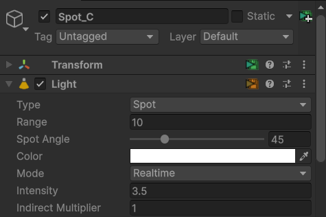
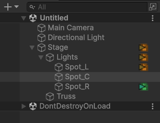

# PlayMode Keeper

[English](README.md) | 日本語

再生中に Inspector で変えた値を、停止後のシーンに書き戻す Unity の Editor 拡張

 

## インストール

Unity 2022.3 以降の Package Manager で `Add package from git URL...` を選び、次の URL を入力します。

```
https://github.com/0xsame/playmode-keeper.git
```

## 使い方

再生中に次の操作で保存した値が、停止したときにシーンへ書き戻されます。

| 操作 | 保存するもの |
| --- | --- |
| コンポーネントの保存ボタン | そのコンポーネント |
| GameObject の保存ボタン | アクティブ、名前、レイヤー、タグ、Static、親と並び順 |
| Hierarchy の保存ボタン | その GameObject と配下のすべて |
| プロパティの右クリックメニューの `Keep This Value After Play` | そのプロパティ |
| `Tools > PlayMode Keeper > Save Selected Objects`（`Alt+Shift+S`） | 選択中の GameObject とそのコンポーネント |

保存ボタンはそのときの値をすべて保存するので、スクリプトやアニメーションが変えた値も書き戻されます。一部の値だけを残すときは、そのプロパティを右クリックして `Keep This Value After Play` を選んでください。

ボタンは保存していない変更があるとオレンジ、保存したあとは緑になります。スクリプトやアニメーションが変えた値は、そのコンポーネントを編集するか、Undo、Redo、保存をするまで色に出ません。

Hierarchy の保存ボタンは、その GameObject か配下に再生中に編集したものか保存したものがある行にだけ表示されます。

再生中に作られた GameObject では、GameObject の保存ボタンに + の印が付きます。押すと、停止後のシーンに配下のオブジェクトも含めて作り直します。

## メニュー

`Tools > PlayMode Keeper`

| 項目 | 内容 |
| --- | --- |
| `Save Selected Objects` | 選択中の GameObject を保存する |
| `Saved Values` | 書き戻していない保存の一覧。1 件ずつ取り消せる |
| `Restore Saved Values` | 残っている保存を書き戻す |
| `Clear Saved Values` | 保存をすべて取り消す |
| `Preferences...` | 設定を開く |

## 設定

`Edit > Preferences... > PlayMode Keeper`

| 項目 | 内容 | 初期値 |
| --- | --- | --- |
| `Enabled` | 保存のボタンとメニューを使う | オン |
| `Save fields hidden from the Inspector` | `[HideInInspector]` のフィールドも保存する | オン |
| `Longest array saved` | 保存する配列の長さの上限 | 10000 |

## 注意

- 削除は書き戻しません。
- スクリプトが作ったマテリアルなど、再生中にだけ存在するものへの参照は書き戻しません。
- プレハブインスタンスの中で親を付け替えた結果は書き戻せません。
- 再生中にスクリプトで読み込んだシーンのオブジェクトは、停止したときにそのシーンが開いていないので書き戻せません。保存した値は残り、Editor を再起動しても消えません。そのシーンを開いて `Restore Saved Values` を選ぶと書き戻します。
- 再生中に作られた GameObject を保存すると、`Assets/PlayModeKeeperSaved` に一時的なプレハブを作り、書き戻したあとで削除します。

## API

Editor 用のスクリプトから `PlayModeKeeper.Keeper` を呼ぶと、ボタンと同じ保存ができます。

```csharp
using PlayModeKeeper;

Keeper.Save(light);
Keeper.Save(light.gameObject, includeChildren: true);
Keeper.SaveProperty(light, "m_Intensity");
```

| メンバー | 内容 |
| --- | --- |
| `Save(params Component[] components)` | コンポーネントを保存する |
| `Save(GameObject gameObject, bool includeComponents = true, bool includeChildren = false)` | GameObject の状態を保存する。`includeComponents` でコンポーネントを、`includeChildren` で配下を含める |
| `SaveProperty(Component component, string propertyPath)` | プロパティを 1 つ保存する |
| `SaveSelection()` | 選択中の GameObject を保存する |
| `ApplySavedValues()` | 保存した値をすぐ書き戻す。再生中は何もしない |
| `ClearSavedValues()` | 保存をすべて取り消す |
| `CanSave` | 保存できるときに `true` |
| `HasSavedValues` | 書き戻していない保存があるときに `true` |
| `Restored` | 書き戻しが終わったときに呼ばれるイベント |

## ライセンス

[MIT](LICENSE.md)
