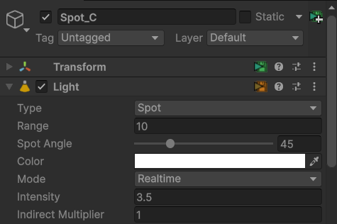
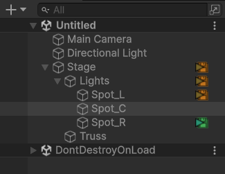

# PlayMode Keeper

English | [日本語](README.ja.md)

A Unity editor extension that writes values changed in the Inspector during Play back to the scene after Play stops.

 

## Installation

In the Package Manager of Unity 2022.3 or later, choose `Add package from git URL...` and enter this URL.

```
https://github.com/0xsame/playmode-keeper.git
```

## Usage

Values saved during Play in any of these ways are written back to the scene when Play stops.

| Action | What is saved |
| --- | --- |
| Save button on a component | That component |
| Save button on a GameObject | Active state, name, layer, tag, static flags, parent and sibling order |
| Save button in the Hierarchy | That GameObject and everything under it |
| `Keep This Value After Play` in a property's context menu | That property |
| `Tools > PlayMode Keeper > Save Selected Objects` (`Alt+Shift+S`) | The selected GameObjects and their components |

A save button saves every value as it is at that moment, so values changed by scripts or animations are written back too. To keep only some of the values, right-click each property and choose `Keep This Value After Play`.

A button turns orange when there are unsaved changes and green once they are saved. A value changed by a script or an animation does not show in the color until the component is edited, or until an undo, a redo or a save.

The save button in the Hierarchy appears only on rows where the GameObject or something under it was edited during Play or has been saved.

For a GameObject created during Play, the GameObject save button shows a + mark. Pressing it recreates the object, together with the objects under it, in the scene after Play stops.

## Menu

`Tools > PlayMode Keeper`

| Item | Description |
| --- | --- |
| `Save Selected Objects` | Saves the selected GameObjects |
| `Saved Values` | Lists the saves not yet written back. Each one can be removed |
| `Restore Saved Values` | Writes back the saves that remain |
| `Clear Saved Values` | Removes all saves |
| `Preferences...` | Opens the preferences |

## Preferences

`Edit > Preferences... > PlayMode Keeper`

| Setting | Description | Default |
| --- | --- | --- |
| `Enabled` | Enables the save buttons and menus | On |
| `Save fields hidden from the Inspector` | Also saves fields marked `[HideInInspector]` | On |
| `Longest array saved` | The longest array that is saved | 10000 |

## Notes

- Deletions are not written back.
- References to things that exist only during Play, such as materials created by scripts, are not written back.
- Reparenting inside a prefab instance cannot be written back.
- Objects in a scene that a script loaded during Play cannot be written back, because that scene is not open when Play stops. The saved values remain, even after the editor restarts. Open the scene and choose `Restore Saved Values` to write them back.
- Saving a GameObject created during Play creates a temporary prefab in `Assets/PlayModeKeeperSaved`, which is deleted after writing back.

## API

Call `PlayModeKeeper.Keeper` from an editor script to save the same way the buttons do.

```csharp
using PlayModeKeeper;

Keeper.Save(light);
Keeper.Save(light.gameObject, includeChildren: true);
Keeper.SaveProperty(light, "m_Intensity");
```

| Member | Description |
| --- | --- |
| `Save(params Component[] components)` | Saves the components |
| `Save(GameObject gameObject, bool includeComponents = true, bool includeChildren = false)` | Saves the GameObject's state. `includeComponents` adds its components and `includeChildren` adds everything under it |
| `SaveProperty(Component component, string propertyPath)` | Saves one property |
| `SaveSelection()` | Saves the selected GameObjects |
| `ApplySavedValues()` | Writes the saved values back immediately. Does nothing during Play |
| `ClearSavedValues()` | Removes all saves |
| `CanSave` | `true` when saving is possible |
| `HasSavedValues` | `true` when there are saves not yet written back |
| `Restored` | Raised when writing back has finished |

## License

[MIT](LICENSE.md)
